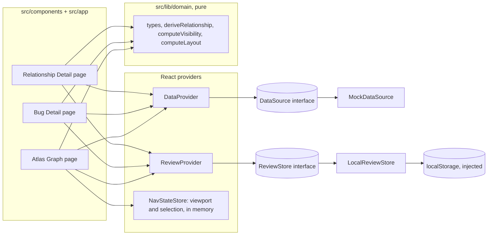

# Design Document: Genome Atlas Core Experience

## Overview

This design covers the Genome Atlas (Version A) interface on invented, clearly labelled mock data. It delivers three views (Atlas Graph, Bug Detail, Relationship Detail), reviewer Accept/Reject decisions stored in localStorage, and the interfaces that let a real dataset, SQLite and LLM-derived fingerprints replace the mock parts later.

Three ideas drive the design:

1. **Cross-project discovery is the product.** The graph clusters bugs by family and makes edges that cross project boundaries visible. The relationship view puts the code of two unrelated projects side by side and links the evidence lines in both.
2. **A review decision is not evidence verification.** Review state (who judged) and evidence provenance (where the evidence came from) are separate fields, derived from separate sources, and always displayed separately.
3. **The graph stays where the Reviewer put it.** Filtering, selecting, reviewing and resizing never move the camera or the nodes. Only first render, the fit control, the Reviewer's own gestures and an explicit restore change the Viewport.

Out of scope, as in the requirements: dataset research, importer, LLM processing, embeddings, SQLite, Variant Hunter.

## Architecture



- UI components import from `domain` and from the provider hooks only. They never import `MockDataSource`, `LocalReviewStore` or `localStorage`.
- One file, `src/lib/composition.ts`, builds the concrete `DataSource` and `ReviewStore` and hands them to the providers in the root layout. This is the single composition point (R11.8).
- All status, visibility and layout logic is in pure functions in `domain`, tested without React, Cytoscape or a browser (R11.7).
- The pages are client components under the App Router. The mock data is bundled, and review decisions exist only in the browser, so server rendering would add no value. The app shell and headings still render on the server.

### Repository layout (adjusts `structure.md`)

```
src/
  app/
    layout.tsx                         root layout, providers, header, banner, live regions
    page.tsx                           Atlas Graph
    bugs/[bugId]/page.tsx              Bug Detail
    relationships/[relationshipId]/page.tsx   Relationship Detail
    not-found.tsx
  components/
    shell/        Header, IllustrativeBanner, SkipLink, RouteAnnouncer, StorageNotice
    graph/        AtlasGraph, GraphCanvas, GraphController, GraphLegend, FilterPanel,
                  CountsBar, GraphList, HoverCard
    bug/          BugHeader, ProjectCard, RelationshipList
    relationship/ EvidenceBench, SnippetPanel, EvidenceList, ConnectorOverlay,
                  ReviewBench, StatusLedger, NegativeExampleCard
    ui/           StatusBadge, ProvenanceBadge, FamilyChip, IllustrativeTag, CodeBlock
  lib/
    domain/       types.ts, status.ts, visibility.ts, layout.ts, search.ts, atlas-query.ts
    data-source/  DataSource.ts (interface), mock/ (dataset + MockDataSource)
    review-store/ ReviewStore.ts (interface), LocalReviewStore.ts, schema.ts
    composition.ts
tests/            unit and property-based tests
```

Approved adjustments, now recorded in `.kiro/steering/structure.md`:
- `src/lib/review-store/` is new. `src/lib/db/` stays reserved for SQLite, so the localStorage store does not belong there.
- The mock dataset lives in `src/lib/data-source/mock/`, not in `data/`. `data/` stays reserved for the future small real sample and evaluation labels, so invented content is never mixed with it.

### Dependencies (approved, each with its reason)

| Package | Reason | Tier |
| --- | --- | --- |
| `next`, `react`, `react-dom`, `typescript` | Stack from `tech.md` | P0 |
| `cytoscape`, `@types/cytoscape` | Graph rendering, required by `tech.md` | P0 |
| `zod` | Validate stored review records and parse the Atlas_Query at trust boundaries; `tech.md` names it. Used only there, not for internal types. | P0 |
| `prism-react-renderer` | Syntax highlighting with token-per-line output, which allows line numbers and range highlighting. Small, synchronous, no WASM. Used only inside `CodeBlock`. | P0 |
| `vitest`, `fast-check` | Unit and property-based tests | P0 |
| `@testing-library/react`, `jsdom` | Component tests; added only when the first component test is written | P1 |

No layout plugin for Cytoscape (such as fcose) is used. Layout is computed by our own deterministic function, which keeps the camera stable and the bundle small.

## Domain model

```ts
type RelationshipStatus = 'evidence-backed' | 'plausible' | 'rejected';
type ReviewState = 'unreviewed' | 'accepted' | 'rejected';
type EvidenceProvenance = 'illustrative';          // widened later: e.g. 'patch-checked'
type Language = 'JavaScript' | 'TypeScript';
type SnippetKind = 'buggy' | 'fixed';

interface Project { id: string; name: string; type: string; description: string }
interface Family  { id: string; name: string; summary: string; color: string; glyph: 'A'|'B'|'C'|'D' }

interface Snippet { lines: string[]; startLine: number }   // <= 25 lines each

interface Bug {
  id: string; title: string; description: string; symptoms: string[];
  suspectedRootCause: string;          // always rendered as a hypothesis
  fixSummary: string;                  // what changed and why it addresses suspectedRootCause; separate from both
  familyId: string; language: Language; projectId: string;
  buggy: Snippet; fixed: Snippet;
  isMock: true;                        // drives every Illustrative_Label
}

interface EvidenceItem {
  id: string; statement: string;
  refs: { bugId: string; snippet: SnippetKind; fromLine: number; toLine: number }[]; // 1 per side
  provenance: EvidenceProvenance;
}

interface Relationship {
  id: string; bugAId: string; bugBId: string;
  explanation: string; baselineStatus: RelationshipStatus;
  evidence: EvidenceItem[]; evidenceProvenance: EvidenceProvenance;
  negative?: { rootCauseA: string; rootCauseB: string };   // set for Negative_Example
  isMock: true;
}

interface ReviewDecision { relationshipId: string; decision: 'accept' | 'reject'; decidedAt: string /* ISO 8601 */ }
```

`isCrossProject(rel, bugsById)` is derived (`bugA.projectId !== bugB.projectId`), never stored, so it cannot disagree with the bugs.

`suspectedRootCause`, `fixSummary` and the snippets are three separate fields. The root cause says what is believed to be wrong. The fix summary says what changed in the fix and why that change addresses the root cause. The snippets are the code itself. The UI never merges them. In the mock dataset every `fixSummary` is invented and is shown under an Illustrative_Label (R4.9, R10.3).

`Review_Decision` has no provenance field. This is how R6.12 holds by construction.

### Status and review state derivation (R6.9, R17)

```ts
function deriveRelationship(rel: Relationship, decision?: ReviewDecision): {
  effectiveStatus: RelationshipStatus;   // accept -> 'evidence-backed', reject -> 'rejected', else baseline
  reviewState: ReviewState;              // accept -> 'accepted', reject -> 'rejected', else 'unreviewed'
  provenance: EvidenceProvenance;        // always rel.evidenceProvenance
}
```

`provenance` reads only from the relationship. No code path from a decision reaches it.

### Display rules for status (R17)

The status is always shown as three separate, labelled items, never merged:

| Item | Source | Example text |
| --- | --- | --- |
| Status | `effectiveStatus` | "Evidence-backed (illustrative)" when provenance is `illustrative` |
| Review | `reviewState` | "Accepted by reviewer", "Rejected by reviewer", "Unreviewed" |
| Provenance | `provenance` | "Illustrative, not verified" |

The Accept button reads "Accept as reviewer judgment". Its helper text reads "Records your judgment. Does not verify the evidence." The word "verified" appears only in the negation "not verified".

## Visibility, filters and counts (R3)

Filter state is a plain object:

```ts
interface Criteria { search: string; families: string[]; languages: Language[]; statuses: RelationshipStatus[] }
```

```ts
function computeVisibility(input: {
  bugs: Bug[]; families: Family[]; relationships: Relationship[];
  effectiveStatus: (relId: string) => RelationshipStatus;
  criteria: Criteria;
}): {
  visibleBugIds: Set<string>;
  visibleRelationshipIds: Set<string>;
  isolatedBugIds: Set<string>;
  counts: { bugs: [number, number]; relationships: [number, number]; families: [number, number]; isolated: number };
}
```

Rules:

1. A bug is visible when it passes search AND (families empty OR its family is selected) AND (languages empty OR its language is selected). Inside one filter the values are OR. An empty filter is inactive.
2. The status filter never hides a bug.
3. A relationship is visible when both its bugs are visible AND (statuses empty OR its effective status is selected).
4. An isolated bug is a visible bug with no visible relationship. It stays on the canvas, dimmed, with the accessible text "no matching relationships". It is counted separately.

Counts shown in the counts bar, each as "visible of total":

| Count | Definition |
| --- | --- |
| Bugs | visible bugs of all bugs |
| Relationships | visible relationships of all relationships |
| Families | distinct families among visible bugs of all families |
| Isolated | isolated bugs, shown only when greater than zero |

Worked example on the mock dataset (12 bugs, 4 families, 10 relationships): selecting only `rejected` leaves 12 of 12 bugs, 1 of 10 relationships, 4 of 4 families, and 10 isolated bugs. The graph then reads as "everything is still here, only one edge matches". This is deliberate: hiding nodes because of an edge filter would make the filter change which bugs exist, and would shuffle the cluster shapes.

Selecting the family "Duplicate execution" instead leaves 3 of 12 bugs, the relationships among those 3, 1 of 4 families and no isolated bugs unless a status filter also applies.

Search is a case-insensitive substring match across title, description, symptoms, suspected root cause, project name and family name. The searchable text of each bug is built once and cached per dataset.

### Criteria in the URL (R2.7, R2.9, R3.14 to R3.16)

The URL is the single source of truth for criteria. Graph zoom and pan are not in the URL.

`
/?q=timeout&family=fam-dup,fam-stale&lang=TypeScript&status=plausible,rejected
`

- `atlas-query.ts` (pure, in `domain`) exports `parseAtlasQuery(params): Criteria` and `serializeAtlasQuery(criteria): string`. Parsing uses a zod schema. Unknown parameters, unknown family ids, unknown languages and unknown statuses are dropped silently. Output is canonical (sorted values, empty criteria omitted), so a round trip is stable.
- The page reads criteria from `useSearchParams()` on every render and passes them to `computeVisibility`. There is no separate criteria state to drift out of sync, so a refresh and browser back or forward both show exactly what the entry's URL says.
- **History.** Every change goes through `router.replace`, so changing criteria never adds a history entry. The graph is one history entry. Back from a detail page returns to it, and its URL carries the criteria. Forward and back between graph entries restore each entry's criteria, because state is read from the URL.
- **Typing.** The search box keeps a local draft value so typing is instant. The draft is written to the URL after a 300 ms pause (debounced). Discrete filter changes (checkbox, chip) write immediately. When the URL changes from outside (back, forward), the draft is reset from the URL.
- **Return from detail pages.** Links from the graph and its list to a detail page carry the current criteria as `?from=<serialized Atlas_Query>`. The detail page's "Back to Atlas" link is `/` plus `serializeAtlasQuery(parseAtlasQuery(from))`. The value is re-parsed and re-serialized, never used as a raw URL, so it cannot redirect elsewhere. Because `from` is in the URL, the back link survives a refresh of the detail page. Following links between detail pages passes `from` along.
- **In-memory `NavStateStore`.** It holds only the Viewport and the selected bug id (R2.8). It does not hold criteria.

## Graph design (R1, R12, R18)

### Visual language

- **Family clusters as compound nodes (approved).** Each family is a Cytoscape compound parent with a text label and a soft translucent hull in the family color. Bugs are its children. The labelled hull makes families readable without color (R14.7) and shows which edges leave a cluster. Guardrails against clutter and interaction problems:
  - Hulls are quiet: 8 percent fill, 1 px border at 30 percent opacity, label in the top-left corner at 12 px, generous padding so edges and node labels do not touch the border.
  - Family parents have `events: no`, `selectable: false` and `grabbable: false`, so every pointer event goes to the bug nodes and edges inside or across the hull. Nodes are not draggable in the MVP, which also protects the deterministic layout.
  - Edges are drawn above hulls. Cross-project edges keep their marker, glow and full opacity, and are never de-emphasized by hull styling.
  - A hidden bug is not removed with `display: none`. Cytoscape computes a compound's bounds only from displayed children, so removing children would shrink and move the hull while filtering. Hidden bugs instead get a `hidden` class: opacity 0, `events: no`, excluded from the list, from fit and from counts. The hull keeps its size and position. When all children of a family are hidden, the hull gets a `hidden` class too. Hidden edges use `display: none`.
  - The hull feature sits behind one flag, `USE_FAMILY_HULLS`, in `GraphController`. If testing shows major layout or interaction problems, turning it off falls back to plain nodes with a family color and a glyph letter, with no change to filtering, layout or the rest of the UI. We revisit the decision after testing.
- **Project encoded by node shape and a letter.** Four projects map to four shapes (circle, rounded square, diamond, hexagon) and a short project tag in the node label, for example `LC-04`. Shape and tag keep the project boundary visible without color.
- **Edges by status.** Color, line style, thickness and an underlay glow all differ:

| Effective status | Color | Line | Glow |
| --- | --- | --- | --- |
| evidence-backed | green `#34D399` | solid, 3 px | strong underlay |
| plausible | amber `#FBBF24` | dashed, 2 px | soft underlay |
| rejected | rose `#FB7185` | dotted, 2 px, with a small cross marker at the midpoint | none, reduced opacity |

- **Cross-project edges** carry a diamond marker at the midpoint and are listed in the legend as "crosses projects". Same-project edges, if the data ever has them, have no marker.
- **Selection focus.** Selecting a node raises its neighbourhood and fades the rest to 25 percent opacity. This changes only style classes, never the Viewport (R1.13, R18.3).
- **Hover card.** An HTML overlay near the pointer shows title, family, project (node) or the two titles, status and cross-project flag (edge). Focusing a list item shows the same card and highlights the matching node or edge.
- **Illustrative marker.** Every node has a small hatched corner badge, and every edge label ends with "(illustrative)" in the accessible description. The persistent banner covers the page.

### Deterministic layout (R18.5)

`computeLayout(families, bugs)` returns `Record<bugId, {x, y}>` with no randomness:

1. Place family centers evenly on a ring, ordered by family id.
2. Place the bugs of each family on a smaller ring around its center, ordered by bug id.
3. Rotate each family's ring by a fixed offset so cross-family edges, such as the negative example, do not run through other nodes.

Cytoscape runs with `layout: { name: 'preset' }`. Nothing re-runs the layout when filters change, so positions never move (R3.13).

### GraphController (the Cytoscape boundary)

`GraphController` is a plain TypeScript class that owns the Cytoscape instance. React components call it through a ref and never touch Cytoscape directly. This isolates the camera rules in one tested place.

| Method | Behavior |
| --- | --- |
| `mount(container)` | Creates Cytoscape with preset positions. Calls `fit` once, after the container has a non-zero size, then marks `initialFitDone` (R18.1). |
| `setElements(data)` | Called once per dataset. Builds nodes, compound parents and edges. |
| `applyVisibility(v)` | In one `cy.batch`, toggles classes `hidden` and `isolated` on bugs, `hidden` on empty hulls and `display` on edges. No layout, no fit, no viewport change (R18.3). |
| `applyStatuses(map)` | Updates the status class of each edge in one batch. No viewport change. |
| `select(bugId \| null)` | Toggles focus classes only. |
| `resize()` | Calls `cy.resize()` only. Does not call `fit`, `zoom` or `pan` (R18.2). |
| `fit()` | Explicit fit control. Fits visible bug nodes (not hidden ones, not hulls). |
| `getViewport()` and `setViewport(v)` | Used to save and restore the camera across navigation (R2.8). |
| `isViewportEmpty()` | True when no visible node intersects the current viewport. Drives the "Fit to results" control (R18.6). |
| `destroy()` | Removes listeners and the instance. |

Resize handling: a `ResizeObserver` on the canvas container calls `controller.resize()`. It also handles the filter panel opening and closing, because that changes the container width. `cy.resize()` re-reads the container size and redraws. It keeps the current zoom and pan.

Viewport restore across navigation: on leaving the Atlas page, the page writes `getViewport()` and the selected bug id into the in-memory `NavStateStore`. On return it calls `setViewport()` after mount and skips the initial fit. A page refresh resets the Viewport, which matches "same browser session" in R2.8.

React integration: the effect that creates the controller runs once per mount. Separate effects feed `applyVisibility`, `applyStatuses` and `select` as props change. None of them can trigger a fit.

### Accessible equivalent (R14.4, R14.5, R15.4)

The canvas is a pointer and touch surface labelled `role="img"` with a text summary. The real keyboard path is `GraphList`, a tabbed list ("Bugs", "Relationships") placed next to the canvas. Each entry is a link to the detail page and shows the same data as the hover card. Entries respect the active filters, and isolated bugs are marked in the text. If Cytoscape fails to initialize, the page shows an error and the list only.

## Relationship Detail design: the Evidence Bench (R5, R12.12, R17)

This view is the centerpiece of the demo. Layout at 1024 px and wider:

```
+--------------------------------------------------------------------------+
| ILLUSTRATIVE banner: all bugs, snippets and relationships are invented   |
+--------------------------------------------------------------------------+
| <- Atlas   Relationship rel-01                                           |
| [Lumen Cart] Double submit creates two orders  <=>  [Pigeon Queue] Job   |
|  processed twice after timeout        (cross-project)                    |
+--------------------------------------------------------------------------+
| Status ledger                                                            |
|  Status: Plausible | Review: Unreviewed | Provenance: Illustrative,      |
|  not verified | Baseline: Plausible                                      |
+---------------------------------------+----------------------------------+
| Explanation (hypothesis)              | Review bench (sticky)            |
| ...                                   |  [Accept as reviewer judgment]   |
| Evidence                              |  [Reject]   [Reset]              |
|  (1) Both run handler without guard   |  Decision: Accepted 12:04        |
|  (2) Fix adds a key check             |  Does not verify the evidence.   |
+---------------------------------------+----------------------------------+
|            BUG A (Lumen Cart)      ~~~~~      BUG B (Pigeon Queue)       |
| Buggy  | 01 function submit() {  |=====|  | 01 async function run() {    |
|        | 02 > await post(...)    |~~~~~|  | 02 > await handle(job)       |
| Fixed  | 01 function submit() {  |     |  | 01 async function run() {    |
|        | 02 > if (sent) return;  |=====|  | 02 > if (seen.has(id)) ...   |
+--------------------------------------------------------------------------+
```

Behavior:

- **2x2 grid.** Columns are Bug A and Bug B. Rows are Buggy and Fixed. A reader scans down one mechanism across both projects (R5.4).
- **Evidence selection.** Selecting an evidence item highlights its line range in all referenced panels at the same time (R5.6) and scrolls each panel to the range.
- **Connector overlay.** `ConnectorOverlay` is an absolutely positioned SVG. It draws a curved ribbon between the highlighted range in Bug A's panel and the highlighted range in Bug B's panel (R12.12). Positions come from the line elements' bounding rectangles. They are recomputed by a `ResizeObserver` and by panel scroll events, throttled with `requestAnimationFrame`. The ribbon is decorative (`aria-hidden`); the same relation is stated in text by the evidence item. When panels are stacked (below 768 px) the overlay is not rendered.
- **Column headers.** Under each bug title: the suspected root cause (hypothesis) and, as a separate item, the fix summary of that bug (R5.11).
- **Negative example card.** For a negative example, `NegativeExampleCard` replaces the neutral explanation header. It shows two columns: "Why it looks similar" and "Why the root causes differ", naming `rootCauseA` and `rootCauseB`. The ledger shows the baseline `rejected` status as usual (R5.10).
- **Status ledger.** The four items (Status, Review, Provenance, Baseline) are separate labelled chips (R5.2, R17.1).
- **Review bench.** Sticky on wide screens, below the explanation on narrow ones. After a decision, the timestamp, the reset control and a live-region message appear. The message reads, for example, "Status is now Evidence-backed (illustrative). Review: accepted by reviewer." (R6.8).
- **Panels.** Each panel is a focusable, scrollable region labelled "{Bug title}, buggy code" (R14.12). Line numbers are not selectable text, so copying code gives clean source.

## Bug Detail design (R4)

Header with title, family chip, language and project tag, followed by two columns (single column below 768 px):

- Left: description, symptoms, then three separate sections: "Suspected root cause (hypothesis)", "Fix summary" (what changed and why it addresses the root cause, with an Illustrative_Label), and the buggy and fixed snippets one above the other (R4.9).
- Right: project card (name, type, description) and a "Related bugs" list. Each entry shows the other bug's title and project, the status badge with the provenance badge, and a link to the relationship. Bugs from other projects come first, so cross-project discovery is the first thing a reader sees.

## Persistence design (R7, R8)

### Interfaces

```ts
interface DataSource {
  listFamilies(): Promise<Family[]>;   listBugs(): Promise<Bug[]>;
  getBug(id: string): Promise<Bug | null>;
  listRelationships(): Promise<Relationship[]>;
  getRelationship(id: string): Promise<Relationship | null>;
  listRelationshipsForBug(bugId: string): Promise<Relationship[]>;
}

interface ReviewStore {
  list(): Promise<LoadResult>;                         // decisions + conditions
  get(relationshipId: string): Promise<ReviewDecision | null>;
  save(d: ReviewDecision): Promise<SaveResult>;        // may report 'not-persisted'
  remove(relationshipId: string): Promise<SaveResult>;
  clear(): Promise<SaveResult>;
}

type StoreCondition =
  | { kind: 'corrupt-data' }
  | { kind: 'partially-recovered'; dropped: number }
  | { kind: 'unavailable-storage' }
  | { kind: 'not-persisted' };
```

`LocalReviewStore` takes an injected `StorageLike` (`getItem`, `setItem`, `removeItem`) so tests use a fake with configurable failures (R16.6). `composition.ts` passes `window.localStorage`, wrapped so that merely accessing it cannot throw.

### Stored format

One key, `bug-genome:review-decisions:v1`. The version is also inside the value:

```json
{ "schemaVersion": 1, "decisions": { "rel-01": { "relationshipId": "rel-01", "decision": "accept", "decidedAt": "2026-01-05T10:00:00.000Z" } } }
```

`decisions` is a map keyed by relationship id, so duplicate ids cannot exist.

### Two-level validation (R8.1 to R8.4)

```
read raw string  (throws or null)
  throws          -> decisions = {}, condition unavailable-storage
  null            -> decisions = {}, no condition
parse envelope with zod: JSON object, schemaVersion === 1, decisions is an object
  fails           -> decisions = {}, condition corrupt-data, stored value left untouched
  passes
    for each [key, value] in decisions:
      record valid iff: value.relationshipId === key
                        AND decision is 'accept' or 'reject'
                        AND decidedAt is a valid ISO 8601 date-time
      valid   -> kept
      invalid -> dropped
    dropped > 0 -> condition partially-recovered(dropped)
```

- Read never writes. Corrupt or invalid records stay in storage until the next successful `save`, `remove` or `clear`, which rewrites the value from the validated in-memory set. This avoids destroying data on a read that might be a transient mistake.
- Records for unknown relationship ids are valid records. They are kept in storage and ignored when computing statuses (R7.7).
- Records are validated one at a time with `safeParse`, so one bad record cannot discard the others.

### Write failures (R8.6)

`save` updates the in-memory set first, then tries `setItem`. If `setItem` throws (quota or otherwise), the in-memory set keeps the decision and the result carries `not-persisted`. The UI therefore keeps working for the session.

### ReviewProvider

Holds `decisions` (a `Map`), `conditions` and the store. Exposes `useReview(relId)` returning `{ decision, effectiveStatus, reviewState, accept, reject, reset }`. Every view reads statuses through it, so a decision updates the graph, the bug page and the relationship page together without reload (R6.4). A cross-tab `storage` event is out of scope.

`StorageNotice` renders each active condition as a dismissible notice that names the condition and says that decisions may not survive a refresh (R8.7).

## Mock dataset (illustrative, authored by hand)

All content is invented and conceptual. It is not a dataset finding and does not show that any real bug family exists. It exists so the Atlas experience can be built and judged.

**Projects (invented):** Lumen Cart (storefront, TypeScript), Pigeon Queue (job queue library, JavaScript), Tessera Sync (offline sync client, TypeScript), Harbor Forms (form library, JavaScript).

**Families (invented labels):**

| Id | Family | Cluster |
| --- | --- | --- |
| fam-dup | Duplicate execution without a guard | A |
| fam-stale | Stale result applied after an async gap | B |
| fam-swallow | Async failure silently dropped | C |
| fam-listener | Listener registered more than once | D |

**Bugs (12):**

| Id | Project | Family | Title (invented) |
| --- | --- | --- | --- |
| bug-01 | Lumen Cart | dup | Double click creates two orders |
| bug-02 | Pigeon Queue | dup | Job runs twice after the visibility timeout |
| bug-03 | Tessera Sync | dup | Retried upload creates a duplicate record |
| bug-04 | Lumen Cart | stale | Old price applied after coupon request |
| bug-05 | Tessera Sync | stale | Slow response overwrites a newer local edit |
| bug-06 | Harbor Forms | stale | Older validation result replaces a newer one |
| bug-07 | Pigeon Queue | swallow | Rejection inside `forEach` callback is lost |
| bug-08 | Lumen Cart | swallow | Fire-and-forget email failure never reported |
| bug-09 | Harbor Forms | swallow | `.then` without `.catch` leaves spinner on |
| bug-10 | Harbor Forms | listener | Success toast appears twice |
| bug-11 | Lumen Cart | listener | Scroll handler added on every render |
| bug-12 | Pigeon Queue | listener | Event hook registered again on reconnect |

**Relationships (10, all cross-project):**

| Id | Bugs | Baseline | Note |
| --- | --- | --- | --- |
| rel-01 | bug-01 and bug-02 | evidence-backed | Same missing guard, two projects |
| rel-02 | bug-01 and bug-03 | plausible | Retry versus double click |
| rel-03 | bug-04 and bug-05 | evidence-backed | Late response applied without a check |
| rel-04 | bug-05 and bug-06 | plausible | |
| rel-05 | bug-04 and bug-06 | plausible | Closes the family triangle |
| rel-06 | bug-07 and bug-09 | evidence-backed | Rejection never observed |
| rel-07 | bug-08 and bug-09 | plausible | |
| rel-08 | bug-10 and bug-11 | evidence-backed | Handler added per render, never removed |
| rel-09 | bug-11 and bug-12 | plausible | |
| rel-10 | bug-01 and bug-10 | rejected | **Negative example** |

`rel-10` connects two bugs whose symptoms look alike ("the action happened twice") across two families. Bug-01 lacks an execution guard. Bug-10 registers a listener on every render, and the correct fix is cleanup, not a guard. The explanation names both root causes. This is the clearest demonstration of "similar symptom, different mechanism".

Coverage check against R9: 12 bugs, 4 families, 4 projects, 10 relationships, all cross-project, each family has at least 2 cross-project relationships, each family spans 3 projects, every bug has at least one relationship, all three baseline statuses appear, one negative example. A validation test enforces each constraint (R16.3).

Each bug has a `fixSummary` of one to three sentences that names the change and says why it addresses the suspected root cause, for example "Adds a per-order key check before posting, so a second submit finds the key and returns early instead of creating another order." (invented, conceptual). It must not repeat the root cause text. The validation test checks that it is non-empty, at most 400 characters and different from `suspectedRootCause` (R9.16). The test cannot judge whether the reasoning is sound, so authoring review does that.

Each bug has buggy and fixed snippets of 8 to 20 lines. Each relationship has 2 to 3 evidence items with one line range per side.

## Visual design system (R12)

Design tokens live in CSS variables in one global stylesheet, shared by all views.

| Token | Value | Use |
| --- | --- | --- |
| `--bg` | `#070B14` | page background, with a radial gradient toward `#0B1424` |
| `--surface` | `#0E1626` | panels |
| `--surface-raised` | `#14203A` | raised cards, hover |
| `--text` | `#E6EDF7` | primary text |
| `--text-muted` | `#9FB0C8` | secondary text |
| `--accent-cyan` | `#22D3EE` | primary accent, focus ring |
| `--accent-teal` | `#2DD4BF` | secondary primary accent |
| `--accent-violet` | `#A78BFA` | restrained second accent |
| status | `#34D399`, `#FBBF24`, `#FB7185` | evidence-backed, plausible, rejected |
| family | `#22D3EE`, `#A78BFA`, `#60A5FA`, `#F0ABFC` | one per family |

Contrast of text and muted text on `--surface` is planned to exceed 4.5:1 and is checked before the polish tier closes (R14.6).

- **Depth:** panels use a 1 px border at low-opacity cyan, a soft inner gradient and a layered shadow. The graph canvas has a faint dot grid.
- **Type:** Inter for the interface and JetBrains Mono for code, loaded through `next/font` (self-hosted at build). Scale: 12, 14, 16, 20, 28, 40 px.
- **Motion:** 150 to 400 ms transitions for hover, focus, status change and view change. Under `prefers-reduced-motion: reduce`, decorative animation is removed and durations drop to 100 ms or less (R12.7).
- **Focus:** a 2 px cyan outline with a 2 px offset on every focusable element, a contrast of at least 3:1 against the surface.
- **Excluded:** no Halloween imagery, no Frankenstein illustrations, no effects over text.

## Navigation, focus and announcements (R2, R14)

- Routes: `/`, `/bugs/[bugId]`, `/relationships/[relationshipId]`, and a not-found page. Unknown ids render the not-found content with a link back (R2.5).
- `RouteAnnouncer` watches the path. On change it sets `document.title` (for example "Relationship rel-01 | Bug Genome Atlas") and moves focus to the single `h1` of the new view (R14.10).
- A skip link is the first focusable element (R14.3).
- Two live regions sit in the root layout: a polite one for filter counts and review results (R6.8, R14.11) and a status region for storage notices.
- Landmarks: one `header`, one `main`, `nav` for the header and the list tabs, `aside` for filters.

## Loading and error states (R11.10, R11.11, R15)

| Situation | Behavior |
| --- | --- |
| Data pending | Skeleton in the affected view, with a text "Loading". |
| Data fails | Message with a Retry button in the affected view. |
| Zero bugs | Atlas shows "No bugs are loaded." |
| No bug matches Node_Criteria | No-results message listing active criteria, with Clear. |
| Edge filter hides every relationship | Notice "No relationships match the active filters". Isolated bugs stay visible. |
| Unknown family id on a bug | Family name "Unknown family", neutral hull color. |
| Cytoscape fails to initialize | Error message and the `GraphList`. |
| Storage problem | Dismissible `StorageNotice`; the views keep working. |

## Correctness properties

Properties for property-based tests with `fast-check`, in addition to unit tests.

1. **Derivation.** For any relationship and optional decision, the effective status equals the status implied by the decision when present, and the baseline otherwise. (R6.9)
2. **Apply then reset.** Applying any decision and then removing it restores the baseline status and `unreviewed`. (R6.10)
3. **Idempotence.** Applying the same decision twice gives the same effective status and review state as once. (R6.11)
4. **Provenance independence.** For any decision, the derived provenance equals the relationship's own provenance. (R6.12, R17.2)
5. **Serialization round trip.** For any valid decision set, serialize then parse gives an equivalent set. (R7.6)
6. **Partition.** For any stored value with a valid envelope, kept plus dropped equals the number of records. (R8.10)
7. **Record isolation.** Adding any invalid record to a valid stored value does not remove or alter any valid record. (R8.3)
8. **Envelope failure.** For any value that is not a valid envelope, the store returns an empty set with `corrupt-data` and leaves the stored value unchanged. (R8.1, R8.2)
9. **Status filter does not hide bugs.** For any criteria, changing only `statuses` leaves `visibleBugIds` unchanged. (R3.6)
10. **Edge visibility.** Every visible relationship has both endpoints visible and a selected status when `statuses` is non-empty. (R3.7)
11. **Isolated count.** The isolated set equals the visible bugs not touched by any visible relationship. (R3.8, R3.9)
12. **Filter monotonicity.** Adding a value to a different filter group never increases visible bugs. Adding a value inside a group never decreases them. (R3.5)
13. **Clear.** Clearing all criteria yields all bugs and all relationships. (R3.10)
14. **Layout determinism.** `computeLayout` on the same input returns identical positions, with no two bugs closer than a minimum distance. (R18.5)
15. **Viewport invariance.** On a headless Cytoscape instance, any sequence of `applyVisibility`, `applyStatuses`, `select` and `resize` calls leaves zoom and pan unchanged. (R18.2, R18.3, R18.7)
16. **Dataset validity.** The mock dataset satisfies every constraint in R9, including the fix summary rules. (R16.3)
17. **Query round trip.** For any `Criteria`, `parseAtlasQuery(serializeAtlasQuery(c))` is equivalent to `c`. (R16.8)
18. **Query robustness.** For any input parameters, `parseAtlasQuery` never throws and returns only known families, languages and statuses. (R3.16)
19. **Hull stability.** On a headless Cytoscape instance with compound parents, applying any visibility change leaves every bug position unchanged and keeps hidden bugs in the parent's bounds. (R18.3)

Cytoscape's headless mode lets property 15 run in Vitest without a browser. Real canvas resizing and the connector overlay positions are checked manually in a browser at the end of each tier, since they depend on real layout.

## Implementation order (by priority tier)

Build in this order. Each tier is complete, tested and demoable before the next starts.

**P0, MVP (complete core experience)**
1. Project setup: Next.js, strict TypeScript, Vitest, fast-check, tokens and fonts.
2. Domain types, status and review-state derivation, visibility and counts, search, layout, with their tests.
3. Mock dataset (12 bugs, 4 families, 10 relationships) and its validation test, `DataSource` and `MockDataSource`.
4. `ReviewStore`, `LocalReviewStore` with two-level validation, its tests with injected storage.
5. Providers, composition point, shell (header, illustrative banner, skip link).
6. Atlas Graph: `GraphController`, clusters, status and cross-project edge styling, filter panel, counts, list, legend, fit.
7. Bug Detail and Relationship Detail with the 2x2 comparison, evidence selection, status ledger, Accept, Reject, Reset.
8. Basic responsive layout and keyboard path through the list.

**P1, Polish**
9. Glow and underlay, hover card, selection focus, connector overlay between evidence ranges, negative example card, motion.
10. Viewport and selection restore across navigation, filter-panel collapse, "Fit to results".
11. Storage notices for unavailable and write errors, loading and error states, remaining responsive and accessibility items, property-based tests.

**P2, Robustness**
12. Reduced-motion handling, touch target audit, live-region polish, graph initialization failure fallback, manual cross-browser check, remaining edge-case tests.

## Approved decisions

| Decision | Outcome |
| --- | --- |
| `fixSummary` on each bug | Approved. Separate from the suspected root cause and the snippets. Invented and illustrative in the mock data. |
| Family clusters as compound nodes | Approved with guardrails: bugs stay clickable, cross-project edges stay visible, no clutter. Revisit during testing, using `USE_FAMILY_HULLS` as the fallback switch. |
| Folder changes | Approved. `src/lib/review-store/` and `src/lib/data-source/mock/`. `data/` stays reserved for real data. Recorded in `structure.md`. |
| Filters in the URL | Approved. Replace-only history, debounced typing, criteria survive refresh, viewport kept out of the URL. |
| Dependencies | Approved: `zod` and `prism-react-renderer`, each used only where the table above says. |

## Out of scope for this design

Real dataset work, importer, LLM integration, embeddings, SQLite, Variant Hunter, and Railway deployment. Deployment is a separate spec after the Atlas is functional and tested.
